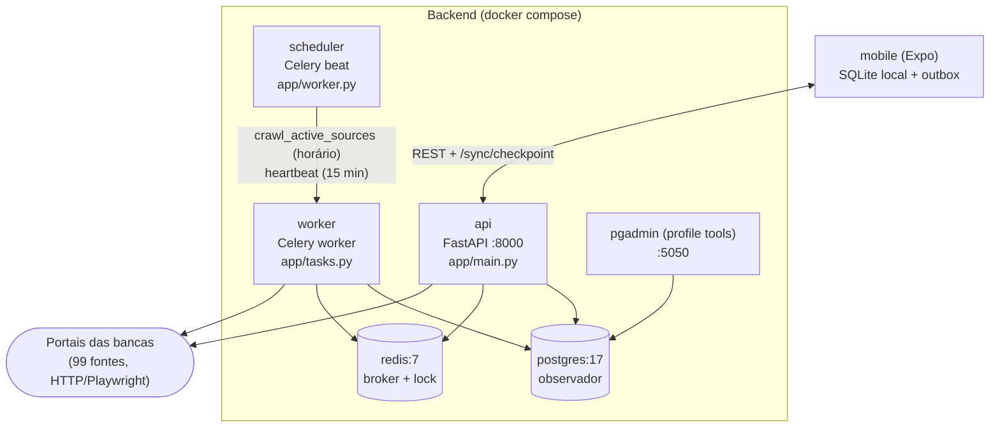
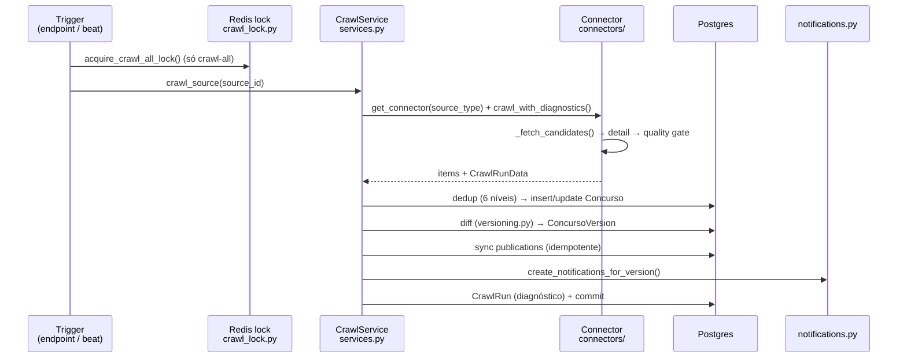
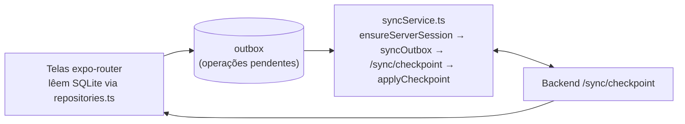

# Arquitetura e mapa do repositório

## Visão geral dos serviços

- `api` serve o REST e executa coletas **síncronas** (`/crawl/.../sync`).
- `worker` executa coletas **enfileiradas** (`crawl_source`, `crawl_active_sources`).
- `scheduler` (beat) agenda `heartbeat` a cada 15 min e `crawl_active_sources` de hora em hora (`app/worker.py`, timezone `America/Sao_Paulo`).
- `postgres` e `redis` sobem com healthcheck (`pg_isready`, `redis-cli ping`); `api/worker/scheduler` só iniciam após `service_healthy`.
- `pgadmin` só sobe com `docker compose --profile tools up`.

## Fluxo de coleta (crawl → versão → notificação)

Pontos importantes do código:

- Deduplicação em 6 níveis em `CrawlService._find_existing_concurso` (`backend/app/services.py`): `(source, external_id)` → `(source, link_pagina)` → `(source, orgao, edital)` → cross-source por `link_pagina` → `(banca, external_id)` → `(banca, orgao, edital_numero)`.
- Mudanças viram `ConcursoVersion` via `diff_concurso`/`classify_change` (`created`, `status_changed`, `dates_changed`, `edital_changed`, `values_changed`, `vacancies_changed`, `document_added`, `updated`) — `backend/app/versioning.py`.
- Só tipos em `SIGNIFICANT_CHANGE_TYPES` geram `Notification` interna (`backend/app/notifications.py`). Não há push externo ainda.
- Falha de uma fonte não derruba o lote: cada fonte tem try/except próprio com rollback e `CrawlRun(status='failed')`.
- `POST /crawl/all` usa lock distribuído no Redis (`observador:crawl_all_lock`, TTL 12h). Concorrente recebe `already_running` ou `503` se o Redis estiver inacessível.

## Conectores (como um portal vira `Concurso`)

- `backend/app/connectors/base.py` — `BaseConnector` com pipeline de fetch em 3 estágios: httpx direto → retry/HttpX com SSL permissivo → Playwright Chromium (fallback para 401/403/429/5xx/Cloudflare). Cada item passa por quality gate (`_is_valid_certame`) e sanity check (`audit_validation.py`).
- `backend/app/connectors/configurable.py` — `ConfigurableHTMLConnector` dirigido por `SourceDefinition` (seletores, padrões de URL de detalhe, `empty_state_patterns`, `mode: open|ongoing|all`).
- `backend/app/connectors/institutional.py` — seleções institucionais (fundações/FAPs) com filtro anti-fomento.
- `backend/app/connectors/dedicated/` — conectores dedicados (nacionais, regionais, plataformas, APIs como CEBRASPE/Reis&Eris/Elo).
- `backend/app/connectors/registry.py` — catálogo `MASTER_SOURCES` (99 fontes) + `get_connector()` + `seed_master_sources()` (idempotente; chamado nos endpoints `/crawl/all*` e no worker agendado).
- `backend/app/connectors/common.py` — parsing pt-BR (datas, `R$`, cidade/UF, área, vagas, links de PDF/inscrição).
- `backend/app/pdf/extractor.py` + `parsers/ibfc.py` — baixa o PDF do edital e extrai texto com `pypdf` (**sem OCR**; limite 30 MB / 120 páginas; escaneado registra erro em `raw_data.pdf` e não quebra a coleta).
- `backend/app/publications.py` — extrai publicações (errata, gabarito, resultado…) do DOM ou das linhas de texto, com hash de dedup `(concurso_id, content_hash)`.

Estados de `CrawlRun`: `success | empty_valid | degraded | blocked | failed`. Vazio sem evidência explícita **nunca** é `empty_valid` — vira `degraded` (`UnconfirmedEmpty`/`AllCandidatesRejected`).

## Fluxo mobile (offline-first)

Detalhes em [MOBILE.md](MOBILE.md). O app nunca consulta a API para listagens: `src/api/*.ts` delega aos repositórios locais; rede só aparece no login/cadastro e no `syncService`.

## Mapa do repositório

### Backend (`backend/app/`)

| Arquivo | Responsabilidade |
|---|---|
| `main.py` | Todas as rotas REST, `lifespan` (`create_all` + `ensure_runtime_schema`), filtros de preferência/alerta |
| `models.py` | 11 tabelas SQLAlchemy (ver [DATABASE.md](DATABASE.md)) |
| `schemas.py` | Contratos Pydantic de request/response |
| `services.py` | `CrawlService`: orquestra coleta → dedup → versão → publicação → notificação |
| `auth.py` | PBKDF2 + JWT HS256 próprio + refresh sessions |
| `notifications.py` | Matching alerta×concurso, tipos significativos, criação de notificações |
| `versioning.py` | Diff normalizado, classificação e resumo de mudanças |
| `crawl_lock.py` | Lock distribuído do crawl-all no Redis |
| `worker.py` / `tasks.py` | App Celery, beat schedule e tasks |
| `database.py` / `config.py` | Engine/sessão e settings (`pydantic-settings`, `.env`) |
| `schema_migrations.py` | ALTERs/`CREATE IF NOT EXISTS` complementares ao `create_all` (MVP) |
| `connectors/` | Catálogo de 99 fontes e crawlers |
| `pdf/` | Extração de texto de edital |
| `live_auditor.py`, `audit_metrics.py`, `audit_validation.py` | Auditoria independente portal×crawler |

`backend/tests/` (18 arquivos de teste) usa SQLite em memória; testes que batem nos portais reais têm marcador `live` (opt-in). `backend/scripts/` tem `run_full_live_audit.py`, `generate_live_audit_docs.py`, `generate_deep_audit_report.py` e `package_delivery.py`.

### Mobile (`mobile/`)

| Caminho | Responsabilidade |
|---|---|
| `app/` | Rotas: `index`→`onboarding`, `login`, `cadastro`, `preferencias-iniciais`, `privacidade-seguranca`, `(tabs)/inicio|busca|atualizacoes|alertas|salvos|perfil`, `concurso/[id]`, `notificacoes` |
| `src/api/` | Fachadas que leem o banco local (`alerts`, `auth`, `client`, `favorites`, `notifications`, `preferences`, `publications`, `updates`) |
| `src/db/` | `database.ts` (schema SQLite + `applyCheckpoint`) e `repositories.ts` (leituras/escritas locais + outbox) |
| `src/sync/` | `syncService.ts` (ciclo de sync) e `background.ts` (task periódica) |
| `src/storage/auth.ts` | Tokens (SecureStore; AsyncStorage no web) + conta offline com verificador SHA-256 |
| `src/providers/AuthProvider.tsx` | Sessão, login online/offline, timers de sync (5 min + foreground) |
| `src/components|constants|theme|utils` | UI (`ConcursoCard`, `UpdateCard`…), listas de áreas/bancas, tema, formatadores |

### Auditoria de fontes (material existente, preservado)

- `docs/SOURCES_STATUS.md`, `docs/LIVE_AUDIT_ISSUES.md`, `docs/LIVE_SOURCES_AUDIT.md`, `docs/source_research_batches/` — snapshots da pesquisa dos portais.
- `backend/docs/`: `CRAWL_INVESTIGATION_2026-08-30.md`, `LIVE_AUDIT_DEEP_RESOLUTION.md`, `LIVE_AUDIT_ISSUES.md`, `LIVE_SOURCES_AUDIT.md`, `SOURCES_STATUS.md`.
- `docs/SOURCE_SITE_RESEARCH_AND_CODEX_RUNBOOK.md` — runbook da pesquisa externa das 99 fontes (contagens = snapshot de 30/08/2026, não estado atual).
- `backend/audit_live_99*.json`, `live_evidence.json` — evidências geradas pelos scripts (não editar à mão).

## Integrações externas

| Integração | Direção | Onde |
|---|---|---|
| Portais das 99 bancas (leitura HTTP / Playwright) | entrada | `connectors/` |
| PDFs de edital (download + `pypdf`) | entrada | `pdf/extractor.py`, `connectors/common.py` |
| PostgreSQL / Redis (via compose) | infra | `docker-compose.yml` |
| Push notifications, e-mail, SMS | **não existe** — notificações são linhas internas em `notifications` lidas pelo app | `notifications.py`, `mobile/src/db/repositories.ts` |
| Webhooks de entrada/saída | **não existe** | — |
