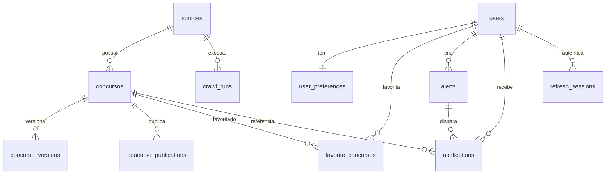

# Banco de dados e modelo de dados

Tecnologia: **PostgreSQL 17** (serviço `postgres` no `backend/docker-compose.yml`, banco `observador`). ORM: SQLAlchemy 2.0 com modelos em `backend/app/models.py`.

> O que está documentado aqui é o schema definido pelo repositório. O estado de qualquer banco “vivo” (volume local, staging, produção) não foi inspecionado e pode divergir.

## Como o schema é criado (sem Alembic)

Apesar de `alembic==1.15.2` constar no `requirements.txt`, **não há diretório de migrações nem `alembic.ini` no repo**. O schema é gerenciado assim:

1. No startup da API (`lifespan` em `backend/app/main.py`): `Base.metadata.create_all(bind=engine)` cria tabelas que faltam. `create_all` **não altera** tabelas existentes.
2. Em seguida, `ensure_runtime_schema(engine)` (`backend/app/schema_migrations.py`) roda `ALTER TABLE ... ADD COLUMN IF NOT EXISTS` / `CREATE TABLE/INDEX IF NOT EXISTS` para colunas e tabelas adicionadas depois (ex.: campos de PDF em `concursos`, tabelas `concurso_versions`, `concurso_publications`, `crawl_runs`, `refresh_sessions`).
3. Nos testes, cada teste cria o schema do zero em SQLite em memória (`Base.metadata.create_all`).

Consequência prática: adicionar coluna nullable nova exige registrá-la também em `schema_migrations.py` (ver [DEVELOPMENT.md](DEVELOPMENT.md)); renomear/remover coluna não é tratado — exige intervenção manual.

## Tabelas

### `sources` — portais monitorados

| Campo | Tipo | Restrição |
|---|---|---|
| `id` | integer PK | index |
| `name` | varchar(150) | not null |
| `base_url` / `list_url` | text | `list_url` nullable |
| `source_type` | varchar(30) | chave do catálogo (`registry.MASTER_SOURCES`); default `html_list` |
| `active` | boolean | default true |
| `frequency_minutes` | integer | default 360 |
| `created_at` / `updated_at` | datetime | |

Sincronizada com o catálogo de 99 fontes via `POST /sources/presets/seed-all` (e automaticamente nos crawls `.../all*` e no worker agendado).

### `concursos` — certames coletados

Chave de negócio: **unique `(source_id, link_pagina)`** (`uq_concursos_source_link_pagina`).

| Grupo | Campos |
|---|---|
| Identidade | `id` PK, `source_id` FK→`sources` (cascade), `external_id` (indexed, nullable), `banca` (not null, indexed), `orgao`, `titulo` (not null), `modalidade`, `cargo`, `area`, `cidade`, `uf(2)`, `status` |
| Números | `vagas` int, `salario_min/max` numeric(12,2), `escolaridade`, `taxa` numeric(10,2), `prova_data` tz |
| Edital/inscrição | `edital_numero`, `edital_data` tz, `inscricao_inicio/fim` tz (indexed), `link_pagina` (not null), `link_edital`, `link_inscricao` |
| PDF | `edital_pdf_text_hash` (indexed), `edital_pdf_pages`, `edital_pdf_excerpt`, `pdf_extracted_at` tz |
| Controle | `resumo`, `raw_data` JSON (inclui `cargo_candidates`, `publications`, `pdf`, amostras de linhas), `content_hash` (indexed, not null), `fetched_at` tz, `created_at/updated_at` |

Índices: `source_id`, `external_id`, `banca`, `orgao`, `area`, `cidade`, `uf`, `status`, `inscricao_inicio/fim`, `prova_data`, `content_hash`, `edital_pdf_text_hash`.

### `concurso_versions` — histórico de mudanças

| Campo | Tipo | Restrição |
|---|---|---|
| `id` | integer PK | |
| `concurso_id` | FK→`concursos` | cascade, indexed |
| `content_hash` | varchar(64) | indexed |
| `change_type` | varchar(50) | `created\|status_changed\|dates_changed\|edital_changed\|values_changed\|vacancies_changed\|document_added\|updated` (+ `none` só interno), indexed |
| `changed_fields` | JSON | `{campo: {label, old, new}}` + `publications_added` |
| `change_summary` | text | texto pt-BR pronto p/ UI |
| `raw_data_snapshot` | JSON | snapshot do `raw_data` |
| `captured_at` | datetime | indexed |

Toda inserção cria versão `created`; updates sem diff relevante só tocam `fetched_at` (sem versão).

### `concurso_publications` — documentos do certame

Unique **`(concurso_id, content_hash)`** (`uq_concurso_publication_hash`). Campos: `id`, `concurso_id` FK cascade, `title` (not null), `publication_type` (`edital|errata|gabarito|resultado|convocacao|lista_inscritos|recurso|comunicado|homologacao|outro` — ver `normalize_publication_type` em `backend/app/publications.py`), `publication_date` tz, `link`, `content_hash`, `raw_data` JSON, `created_at/updated_at`. Inserção via `INSERT ... ON CONFLICT DO NOTHING` (idempotente, funciona em Postgres e SQLite).

### `crawl_runs` — diagnóstico de cada coleta

Por `(source, execução)`: `started_at/finished_at/duration_ms`, `status` (`success|empty_valid|degraded|blocked|failed`), `http_status`, `browser_used`, contadores (`candidates_found/rejected`, `processed`, `inserted/updated/unchanged`, `versions_created`, `notifications_created`), `error_type/message`, `diagnostics_payload` JSON (rejeições com motivo, sanity, `empty_evidence`). Consultar via `GET /sources/{id}/runs` e `GET /runs/recent`.

### Usuários e personalização

| Tabela | Chave/único | Campos principais |
|---|---|---|
| `users` | `email` unique | `name`, `password_hash` (PBKDF2), `is_active`, timestamps |
| `user_preferences` | `user_id` unique (1:1) | `areas/ufs/cidades/bancas/cargo_keywords` JSON, `only_open` (default true), `notification_channels` JSON |
| `favorite_concursos` | unique `(user_id, concurso_id)` | `concurso_id` FK cascade |
| `alerts` | — (vários por usuário) | `name`, `active`, `uf`, `cidade`, `banca`, `area`, `cargo_keyword`, `status`, `only_open` |
| `notifications` | unique `(user_id, alert_id, concurso_id, notification_type)` | `notification_type` (`alert_match` ou `document_added_{v}`/`version_update_{v}`), `title`, `message`, `read_at` |
| `refresh_sessions` | `token_hash` unique | `user_id` FK cascade, `expires_at`, `revoked_at` (só o hash SHA-256 é guardado) |

Cascatas: deletar `Source` apaga seus `concursos` (e em cascata versões/publicações/favoritos/notificações ligadas); deletar `User` apaga preferências, favoritos, alertas, notificações e sessões. `Notification.alert_id` usa `SET NULL`.

## Diagrama entidade-relacionamento



## Operações locais

Subir e criar schema (o `lifespan` da API cria tudo sozinho):

```powershell
cd backend
docker compose up --build
```

Semear as 99 fontes:

```powershell
Invoke-RestMethod -Method POST http://localhost:8000/sources/presets/seed-all
```

Inspecionar via pgAdmin (perfil opcional `tools`):

```powershell
docker compose --profile tools up -d pgadmin   # http://localhost:5050 (admin@observador.local / admin)
```

Resetar o banco local (**DESTRUTIVO** — apaga todos os dados do volume):

```powershell
docker compose down -v
docker compose up --build
```

Reset cirúrgico (preserva o volume, apaga só coletas de uma fonte; concursos deletados são recriados no próximo crawl como `created`):

```powershell
Invoke-RestMethod -Method DELETE http://localhost:8000/sources/1/concursos
```

Não há seed de usuários/concursos de exemplo nem fixtures SQL — os testes criam tudo em memória.

## Regras de dados e ciclo de vida (visíveis no código)

- `is_concurso_open()` (`notifications.py`): sem `inscricao_fim` = aberto; senão compara com agora (UTC). Usado por alertas (`only_open`), `GET /me/updates` e `POST /me/alerts/run/sync`.
- Matching de alerta (`alert_matches_concurso`): UF exata (case-insensitive); cidade/banca/status por substring; área exata **ou** por palavras-chave (`AREA_KEYWORDS`: assistência social, administrativa, saúde, educação, TI); `cargo_keyword` busca em título+órgão+cargo+área+cidade+UF+resumo+`cargo_candidates`.
- `only_open` default `true` em preferências e alertas.
- E-mail normalizado (trim+lowercase) no registro/login; senha mínima de 6 caracteres; duplicado retorna `409`.
- Refresh token: só o hash é persistido; cada uso (`POST /auth/refresh`) estende a expiração (~10 anos a partir de então); revogação via `revoke_refresh_token` (sem endpoint público atualmente — ver [API.md](API.md)).
- `content_hash`/`edital_pdf_text_hash` (SHA-256) detectam mudanças de conteúdo e de PDF.
- `publications` de um crawl são sincronizadas antes do diff, de modo que documentos novos entram no `changed_fields.publications_added` e classificam como `document_added`.
